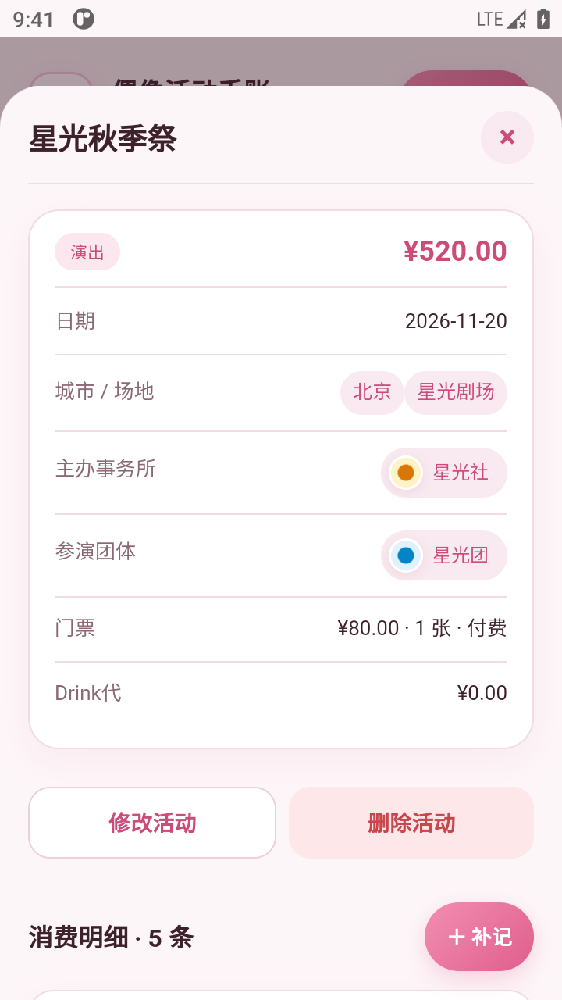
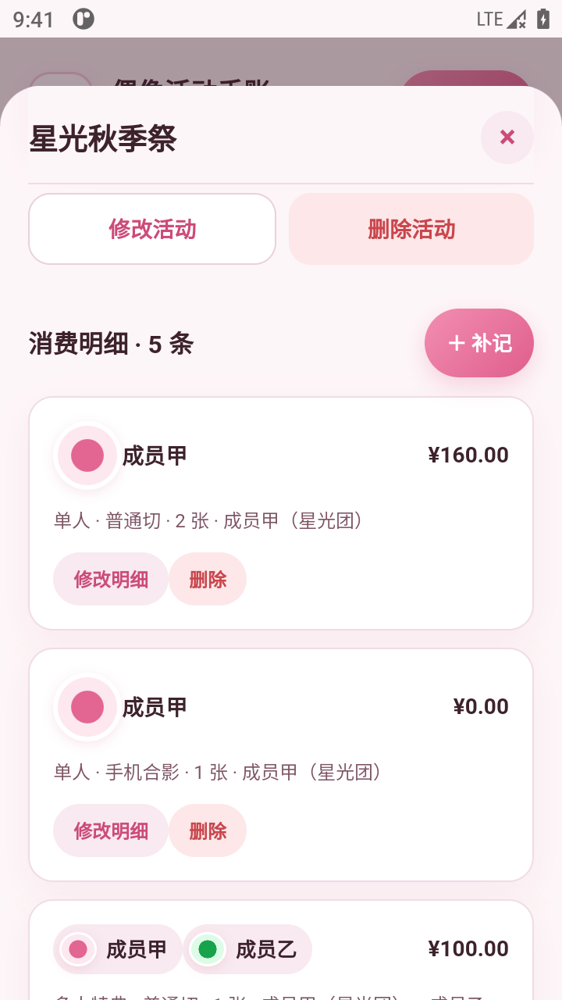
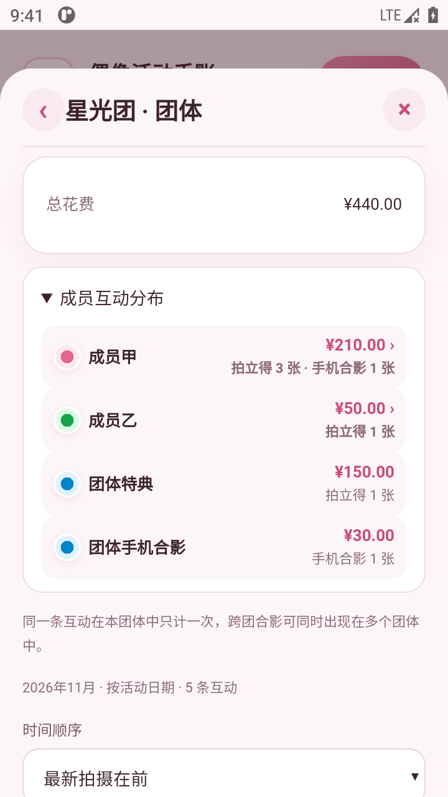
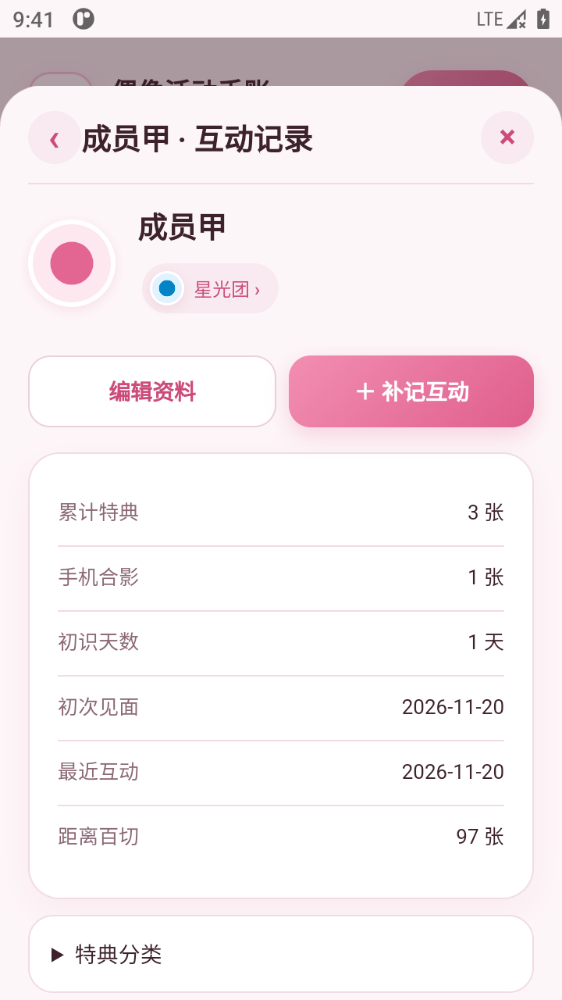

# 偶像活动手账

离线运行的偶像活动记录与消费统计 Android 应用，支持 Android 8.0 及以上系统，无需网络权限。

[下载 APK](./偶像活动手账_Android_v1.3.3.apk) · [程序源码](./source/README.md)

## 软件功能

- **手账总览与月度预算**：展示当月总支出、活动记录、演出场次、特典张数及各分类消费构成；支持设置默认及指定月份预算与进度条提醒。
- **活动记录与智能筛选**：记录演出、单独特典会、电切、宿题/主题、off会、周边与其它活动；筛选下拉栏仅显示所选时间段内的有记录选项，默认“全部”选项置顶，其余选项按出现次数与最近日期排序，并支持关键词与拼音搜索。
- **丰富的可点击联动与逐层返回**：活动详情中的主办事务所、参演团体（带团体头像）、城市/场地、消费明细中的成员头像与团体头像、周边关联对象，以及成员/团体/事务所/照片详情中的关联信息均可直接点击下钻查看；内置多层级页面返回栈，点击左上角返回按钮或系统返回键可逐层退回上一页面。
- **灵活的消费明细**：支持单人特典、多人特典（参与成员平均分摊）、团体特典、周边商品（支持单次添加多件周边并多选关联成员、团体与事务所）及手机合影；支持自定义特典形式与历史单价自动匹配。
- **统计分析与足迹回顾**：
  - **总览**：统计选定周期内的支出概况、对象花费（成员、团体花费，以及按主办活动门票与旗下偶像团体花费汇总的事务所花费排行及占比进度条，支持点击下钻查看详情）、消费构成占比、与上期比较、支出趋势图、活动分布、特典形式、门票汇总、周边排行、偶活日历与年度回顾。
  - **成员 / 拍切记录 / 团体 / 足迹**：成员拍切排行榜与距离百切/初识天数统计、拍切互动时间线筛选、团体详情（含总花费以及区分拍立得、手机合影、团体特典与团体手机合影的成员互动分布）、城市与场馆消费足迹统计。
- **合影相册与视频支持**：统一管理 `演出合影`、`拍立得合影` 与 `手机合影`，照片与视频日期自动与所属活动及记录时间保持同步；支持从系统相册一次添加多张照片，手机合影支持添加常见格式视频（MP4 / MOV / WebM / MKV / 3GP / M4V），自动生成视频封面缩略图，同时提供应用内网页播放与原生硬件视频播放器全屏播放，并支持一键保存照片与视频至系统相册。
- **档案管理与个性化**：成员档案管理、团体管理与事务所管理均按互动次数与花费排序，支持成员别名/代表色/头像/社交账号/初次见面、团体头像与归属事务所、主办事务所头像备注与批量关联；提供浅色 / 深色 / 跟随系统外观与多级字体缩放。
- **本地存储与完整备份**：所有数据保存于本机私有存储，自动保留上一次保存快照以防误删误改；支持导出与导入最大 10 GB 的完整 ZIP / JSON 备份文件，支持备份内容预览及合并/覆盖恢复。

## 发布包说明

发布包内含签名 APK 安装包、功能示例截图、完整程序源码及 `SHA256.txt` 校验值。版本代码 17，数据格式 7。

## 功能示例

| 活动参演团体头像 | 明细成员头像可点 | 团体互动分布区分 | 逐层返回上一页 |
| --- | --- | --- | --- |
|  |  |  |  |
