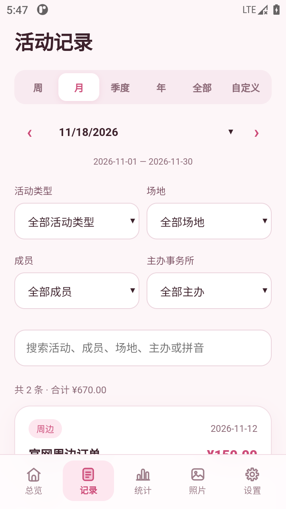
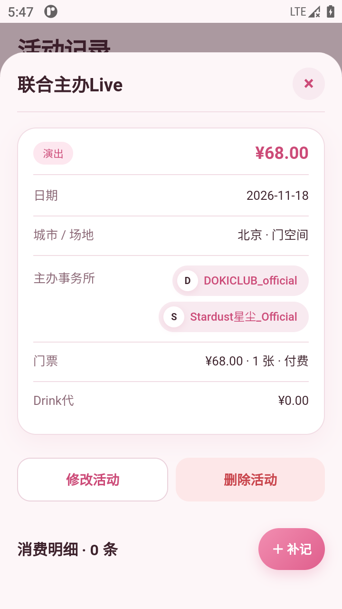
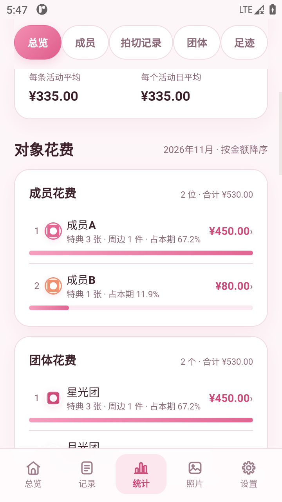
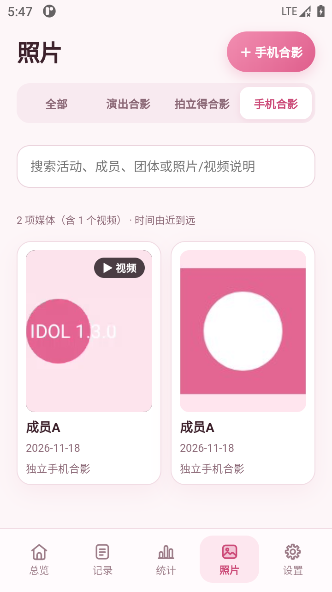
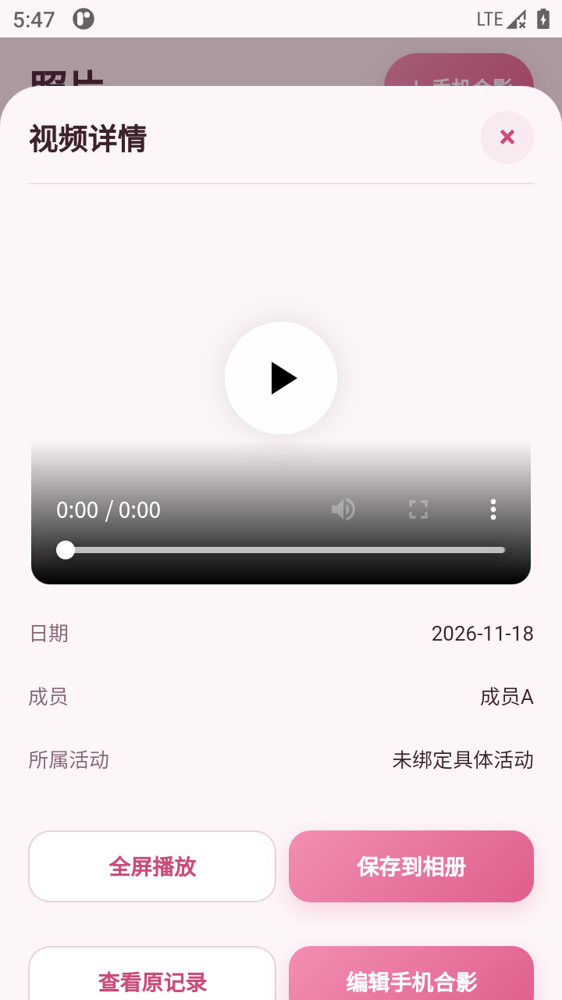
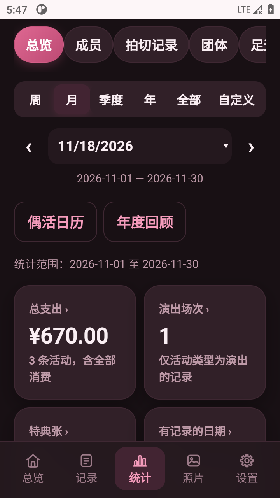

# 偶像活动手账

离线运行的偶像活动记录与消费统计 Android 应用，支持 Android 8.0 及以上系统，无需网络权限。

[下载 APK](./偶像活动手账_Android_v1.3.0.apk) · [程序源码](./source/README.md)

## 软件功能

- **手账总览与月度预算**：展示当月总支出、活动记录、演出场次、特典张数及各分类消费构成；支持设置默认及指定月份预算与进度条提醒。
- **活动记录与搜索筛选**：记录演出、单独特典会、电切、宿题/主题、off会、周边与其它活动；支持按时间范围、活动类型、场地、成员与主办事务所多条件筛选，并支持名称、备注及拼音实时搜索。
- **灵活的消费明细**：支持单人特典、多人特典（参与成员平均分摊）、团体特典、周边商品（支持单次添加多件周边并多选关联成员、团体与事务所）及手机合影；支持自定义特典形式与历史单价自动匹配。
- **统计分析与足迹回顾**：
  - **总览**：统计选定周期内的支出概况、对象花费（成员、团体与事务所花费明细及占比进度条，支持下钻查看详情）、消费构成占比、与上期比较、支出趋势图、活动分布、特典形式、门票汇总、周边排行、偶活日历与年度回顾。
  - **成员 / 拍切记录 / 团体 / 足迹**：成员拍切排行榜与距离百切/初识天数统计、拍切互动时间线筛选、团体互动总额及成员分布详情、城市与场馆消费足迹统计。
- **合影相册与视频支持**：统一管理 `演出合影`、`拍立得合影` 与 `手机合影`；支持从系统相册一次添加多张照片，手机合影同时支持添加与播放 MP4、MOV、WebM、MKV、3GP、M4V 等常见格式视频，支持全屏查看/缩放/播放并导出至系统相册。
- **成员 / 团体 / 事务所档案与个性化**：管理成员（别名、代表色、头像、所属团体、社交账号与初次见面日期）、团体与主办事务所（头像、备注及批量关联），提供浅色 / 深色 / 跟随系统外观与多级字体缩放。
- **本地存储与完整备份**：所有数据保存于本机私有存储，自动保留上一次保存快照以防误删误改；支持导出与导入最大 10 GB 的完整 ZIP / JSON 备份文件，支持备份内容预览及合并/覆盖恢复。

## 发布包说明

发布包内含签名 APK 安装包、功能示例截图、完整程序源码及 `SHA256.txt` 校验值。版本代码 14，数据格式 7。

## 功能示例

| 记录与筛选搜索 | 活动详情与主办 | 总览花费统计 | 手机视频合影 | 视频详情播放 | 深色与大字号 |
| --- | --- | --- | --- | --- | --- |
|  |  |  |  |  |  |
